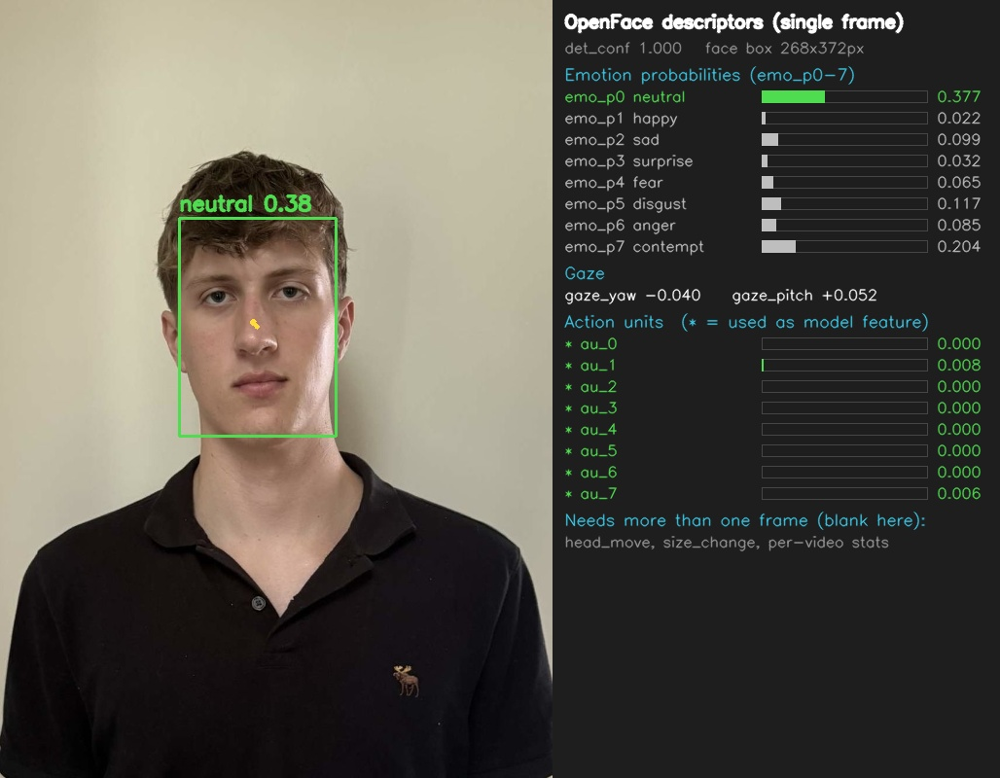

# Lie Detection ML (2026)

A machine learning pipeline that tries to classify short videos of a person as **truthful** or **deceptive** using two signals: **facial behavior** (emotion, gaze, facial action units, head movement) and **vocal/speech behavior** (acoustic features, pauses, filler words, speech timing). Features are normalized per subject against that subject's own baseline video, then evaluated with subject-independent cross-validation.

> **Research/educational project.** Facial and vocal cues are weak and inconsistent indicators of deception. Results from this code should not be used to judge real people or in any legal, hiring, or security setting.

## How It Works

1. **Face feature extraction** (`openface_extraction.py`): Samples each video at 5 FPS, detects the face with OpenFace (RetinaFace), and runs OpenFace's multitask model to get per-frame emotion probabilities (8 classes), gaze yaw/pitch, and facial action unit (AU) activations, plus the face bounding box.
2. **Audio feature extraction** (`opensmile_build_features.py`): Extracts the audio track with ffmpeg, computes the **eGeMAPSv02** functionals with openSMILE, and transcribes speech with **faster-whisper** (`base.en`, word timestamps). From the transcript it derives timing features: response latency, speech rate, pause counts and lengths, filler-word rate (um, uh, hmm...), and mean word confidence.
3. **Dataset building** (`openface_build_dataset.py`): Aggregates each video's frame-level face features into summary statistics (mean, std, min, max, slope, mean absolute change), merges in the audio features, and subtracts each subject's **baseline** average so the model sees deviations from that person's normal behavior. Videos with a face in fewer than 50% of frames, or from subjects with no baseline video, are dropped.
4. **Evaluation** (`openface_evaluate.py`): Compares logistic regression and random forest on three feature sets (face only, voice only, both) using `GroupKFold` by subject, so no person appears in both train and test. Reports accuracy with a 95% confidence interval, balanced accuracy, a confusion matrix, and a permutation test p-value to check whether performance beats chance.

## Project Structure

```
Lie_Detection-_ML2026/
├── openface_extraction.py            # Per-frame face features from video (OpenFace)
├── opensmile_build_features.py       # Per-video voice + transcript timing features
├── openface_build_dataset.py         # Aggregates features, applies baseline normalization
├── openfacemouth_build_dataset.py    # Variant of the dataset builder
├── openface_evaluate.py              # Subject-grouped CV, models, permutation tests
├── weights/                          # OpenFace model weights (see below)
├── annotated.jpg                     # Example annotated face output
├── annotated_single.jpg              # Example descriptor output shown in this README
└── .gitignore.txt
```

Generated at runtime (not in the repo):

```
videos/<subject>/<label>_*.mp4        # your input videos
features/frames/<subject>__<video>.csv
features/audio/<subject>__<video>.csv
features/audio/transcripts/*.txt
features/dataset.csv
```

## Input Data Format

Place videos in `videos/<subject>/`, and **start each filename with its label**:

```
videos/
├── subject01/
│   ├── baseline_1.mp4
│   ├── truth_1.mp4
│   └── lie_1.mp4
└── subject02/
    └── ...
```

- `baseline`: the subject speaking normally. Used only to normalize that subject's other videos.
- `truth` / `lie`: the labeled clips used for training and evaluation.
- Supported extensions: `.mp4`, `.mov`, `.avi`, `.mkv`, `.m4v`.

Each subject needs at least one baseline video, and you need at least 2 subjects (10 or more recommended) for the evaluation to be meaningful.

## Requirements

- Python 3.9+
- [OpenFace 3.0](https://github.com/CMU-MultiComp-Lab/OpenFace-3.0) (`openface` package) and its pretrained weights in `weights/`: `Alignment_RetinaFace.pth`, `MTL_backbone.pth`, and `mobilenetV1X0.25_pretrain.tar` (the face detector loads this one via a relative path, so run the scripts from the project folder)
- `torch`, `opencv-python`, `numpy`, `pandas`, `scikit-learn`
- `opensmile`, `faster-whisper`, `imageio-ffmpeg`

```bash
pip install torch opencv-python numpy pandas scikit-learn
pip install opensmile faster-whisper imageio-ffmpeg
# plus OpenFace 3.0 per its own install instructions
```

The scripts run on CPU by default (`DEVICE = "cpu"`); change it in `openface_extraction.py` if you have a GPU.

## Usage

Run the steps in order from the project folder:

```bash
python openface_extraction.py          # 1. face features  -> features/frames/
python opensmile_build_features.py     # 2. voice features -> features/audio/
python openface_build_dataset.py       # 3. build dataset  -> features/dataset.csv
python openface_evaluate.py            # 4. cross-validate and report
```

Both extraction scripts skip videos that already have an output CSV, so you can re-run them to resume. Settings you may want to change live at the top of each file (`SAMPLE_FPS`, `WHISPER_MODEL`, `PAUSE_MIN`, `MIN_FACE_RATIO`, `USE_BASELINE`, `USE_AUDIO`, `N_PERMUTATIONS`).

## Example Output

The face extraction step produces one row of descriptors per sampled frame. For a single frame, OpenFace returns:



- **Face box and detection confidence** from the RetinaFace detector.
- **8 emotion probabilities** (`emo_p0` to `emo_p7`: neutral, happy, sad, surprise, fear, disgust, anger, contempt).
- **Gaze** as yaw and pitch (`gaze_yaw`, `gaze_pitch`), shown as the arrow on the face.
- **8 facial action units** (`au_0` to `au_7`), all of which are used as model features.

Head movement and face-size change are computed between consecutive frames, and the per-video statistics (mean, std, min, max, slope, mean absolute change) are computed across all frames of a video, so they don't appear in a single-frame view. In the full pipeline these frame-level values are aggregated per video and normalized against the subject's baseline.

## Features

| Source | Features |
|---|---|
| Face (per frame) | 8 emotion probabilities, gaze yaw/pitch, action units, head movement, face-size change |
| Face (per video) | mean, std, min, max, slope, mean absolute change of each frame feature |
| Voice | eGeMAPSv02 acoustic functionals (openSMILE) |
| Speech timing | word count, response latency, speech span and rate, pause count/mean/max/ratio, long pauses, filler count and rate, mean word probability |

## Evaluation

| Setting | Value |
|---|---|
| Models | Logistic regression (C=0.1), random forest (200 trees) |
| Feature sets | face, voice, both |
| CV | `GroupKFold` by subject (up to 10 folds) |
| Metrics | accuracy + 95% CI, balanced accuracy, confusion matrix |
| Significance | Permutation test (100 permutations); chance accuracy is 0.50 |

### Results

Add your results here after running the evaluation:

| Features | Model | Accuracy | p-value |
|---|---|---|---|
| face | logistic regression | _TBD_ | _TBD_ |
| voice | random forest | _TBD_ | _TBD_ |
| both | random forest | _TBD_ | _TBD_ |

## Limitations

- Small datasets give wide confidence intervals; treat accuracy near 50% as no better than chance.
- Baseline normalization requires a baseline video for every subject.
- Behavior in staged or scripted lies may not generalize to real-world deception.
- Lighting, camera angle, accents, and recording quality all affect the extracted features.

## License

No license specified yet. Consider adding one (for example MIT) if you want others to reuse the code.
